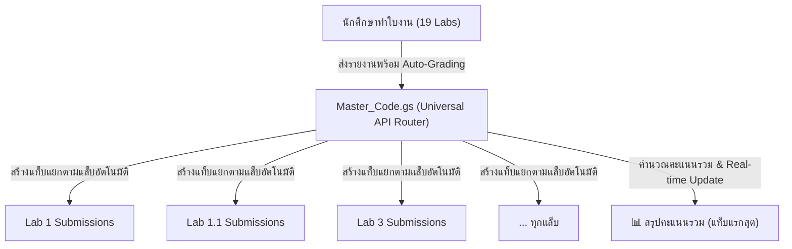

# 🌟 คู่มือการติดตั้งและใช้งานระบบส่งใบงานปฏิบัติการ IoT ออนไลน์
### IoT Lab Worksheets Portal & Universal Master Gradebook System (ESP32 / ESP8266)

โปรเจกต์นี้คือระบบเว็บแอปพลิเคชันใบงานปฏิบัติการแบบอินเทอร์แอคทีฟ (Interactive IoT Lab Worksheets) ครอบคลุม **19 ใบงานปฏิบัติการ** ในหลักสูตร **Hybrid Local/Cloud IoT Node ด้วย ESP32 / ESP8266** และโมดูลเสริมระดับอุตสาหกรรม โดยคุณครูผู้สอนสามารถเลือกใช้งานได้ตามความเหมาะสมของสภาพแวดล้อม:

1. **ระบบคลาวด์รวมศูนย์ชีตเดียว (Universal Master Gradebook - แนะนำที่สุด)**: ส่งคะแนนทั้ง 19 แล็บลงใน Google Sheet ไฟล์เดียว แยกแท็บตามแล็บอัตโนมัติ พร้อมหน้าสรุปคะแนนรวม
2. **ระบบคลาวด์แยกชีตรายแล็บ (Individual Google Sheets)**: ปรับใช้ชีตแยกเป็นรายแล็บอิสระต่อกัน
3. **ระบบจำลองเซิร์ฟเวอร์โลคอล (Local Simulation Server - ออฟไลน์ 100%)**: สำหรับห้องเรียนเครือข่ายปิด (LAN) รันผ่าน Node.js บนคอมพิวเตอร์ครู

---

## 📑 สารบัญใบงานปฏิบัติการ (19 Labs & Modules)

| โมดูล | รหัสแล็บ | ชื่อใบงานปฏิบัติการ | จุดเด่นการเรียนรู้ |
| :--- | :--- | :--- | :--- |
| **Module 1: ฮาร์ดแวร์ & อินพุต/เอาต์พุต** | `lab0` / `lab0-basic` | การเตรียมสภาพแวดล้อม & Pinout ESP32/ESP8266 | Arduino IDE 2.x, Wokwi Simulator, ไฟกระพริบ |
| | `lab1` | การอ่านค่าเซ็นเซอร์และควบคุมเอาต์พุต | GPIO, ADC (0-4095), Relay ควบคุมพัดลม/ปั๊มหมอก |
| | `lab1.1` | การควบคุมเอาต์พุตด้วยสวิตช์ปุ่มกด | Software Debounce, Edge Detection, Long Press |
| | `lab2` | การแสดงผลผ่านจอ OLED SSD1306 | I2C Bus, Wire Library, กราฟิกและสถานะอุปกรณ์ |
| **Module 2: ไร้สาย & เว็บเซิร์ฟเวอร์ฝังตัว** | `lab3` | การเชื่อมต่อ Wi-Fi & RSSI Scan | WiFi STA Mode, วิเคราะห์ความแรงสัญญาณ RSSI |
| | `lab3.1` | เว็บเซิร์ฟเวอร์บน ESP32 (LittleFS Web Server) | Web Server ฝังตัว, จัดเก็บไฟล์เว็บใน LittleFS |
| | `lab3.2_Wifi_UI_config` | ตั้งค่า Wi-Fi ผ่านหน้าเว็บ UI + OLED Debug | UI Form Config, EEPROM/Flash, แสดงผล OLED |
| | `lab4` | การสื่อสารสองทางเรียลไทม์ (Local WebSockets) | Full-Duplex WebSockets, ควบคุมฮาร์ดแวร์หน่วงเวลาต่ำ |
| | `lab4.1` | ระบบควบคุมและมอนิเตอร์ฮาร์ดแวร์หลายจุด | Multi-Client WebSockets, Synchronized State |
| **Module 3: สื่อสารคลาวด์ & โครงงานบูรณาการ** | `lab5` | การส่งข้อมูลระดับคลาวด์ผ่าน Cloud MQTT | MQTT Broker (HiveMQ/EMQX), Pub/Sub Architecture |
| | `LAB5_Dev` | MQTT Telemetry Node (DHT Sensor) | JSON Telemetry, Non-blocking millis, Keep-alive |
| | `lab6` | โครงงานบูรณาการ Hybrid Node ขั้นสูง | Local Web Server + Cloud MQTT Fallback Node |
| | `LAB6.1Perform` | Industrial Hybrid Node Throughput & Config | วัด Latency, Packet Loss, Rate Limiting, OTA |
| **Module 4: การประมวลผล & วิเคราะห์ข้อมูล** | `lab7` | การเชื่อมโยงข้อมูล & แดชบอร์ดด้วย Node-RED | Low-Code Flow Based, Data Pipeline, Dashboard |
| | `lab8` | การบันทึกสถิติมิติตามเวลาด้วย InfluxDB | Time-Series Database, Data Retention Policy |
| | `lab9` | การวิเคราะห์และแสดงผลข้อมูลด้วย Grafana | Data Visualization, Panel Panels, Query Editor |
| **Module 5: ใบงานเสริม & แอปพลิเคชัน** | `lab-extra` | พัฒนา Web Dashboard ด้วย HTML, CSS & JS | Frontend Responsive, Fetch API, Chart.js |
| | `lab-webconfig_wifi` | ตั้งค่า Wi-Fi ผ่าน Captive Portal | AP Mode Auto-Redirect, Dynamic Network Pairing |
| | `LAB_Fleet` / `LAB_Convert2app` | การบริหารจัดการบอร์ดขนาดใหญ่ & แปลงเป็น App | Fleet Management, PWA, Android APK, Desktop Exe |

---

## 🌟 ระบบที่ 1: Universal Master Gradebook (แนะนำที่สุด - รวมคะแนนทุกแล็บใน 1 Sheet)

ใช้ไฟล์ Google Sheet เดียวกันสำหรับทุกใบงาน ระบบจะสร้างแท็บแยกของแต่ละแล็บให้อัตโนมัติ (`Lab 0 Submissions`, `Lab 1 Submissions`, `Lab 3 Submissions` ฯลฯ) พร้อมแท็บหน้าแรก **"📊 สรุปคะแนนรวม"** สรุปคะแนนและสถิติการส่งงานของผู้เรียนทุกคนแบบ Real-time



### ขั้นตอนการติดตั้ง Master_Code.gs ใน Google Sheet:
1. **เปิด Google Sheet ของอาจารย์**: เปิดไฟล์ Google Sheet เปล่า หรือไฟล์เดิมที่มีอยู่
2. **เปิด Apps Script**: ไปที่แถบเมนูด้านบน เลือก **ส่วนขยาย (Extensions)** $\rightarrow$ **Apps Script**
3. **วางโค้ด**: ลบโค้ดเดิมออก แล้วนำโค้ดทั้งหมดจากไฟล์ [`Master_Code.gs`](file:///Users/allarmmac/myjob_folder/MyLaB/IoT/Master_Code.gs) ไปวาง
4. **บันทึก**: กดปุ่ม 💾 **บันทึกโครงการ (Save)**
5. **Deploy เป็น Web App**:
   - คลิกปุ่มสีน้ำเงินมุมขวาบน **การทำให้ใช้งานได้ (Deploy)** $\rightarrow$ **การทำให้ใช้งานได้รายการใหม่ (New deployment)**
   - เลือกประเภทบริการเป็น **เว็บแอป (Web app)**
   - **คำอธิบาย (Description):** `IoT Master Gradebook`
   - **ดำเนินการในฐานะ (Execute as):** `ฉัน (Me / your email)`
   - **ใครมีสิทธิ์เข้าถึง (Who has access):** **`ทุกคน (Anyone)`** *(สำคัญมาก)*
   - กดปุ่ม **Deploy** และทำการอนุมัติสิทธิ์ (Review Permissions)
6. **นำ Web App URL ไปเชื่อมต่อ**:
   - **ผ่านหน้าเว็บ UI:** เปิดหน้า [index.html](file:///Users/allarmmac/myjob_folder/MyLaB/IoT/index.html) หรือ [dashboard.html](file:///Users/allarmmac/myjob_folder/MyLaB/IoT/dashboard.html) $\rightarrow$ คลิกปุ่ม **"จัดการลิงก์ส่งคะแนน Google Sheets"** $\rightarrow$ นำ URL มาวางในช่อง Master URL $\rightarrow$ กดปุ่ม **"บันทึก Master URL"** หรือกด **"🔄 บังคับใช้ Master กับทุกแล็บ"**
   - **ผ่านไฟล์คอนฟิก:** ใส่ URL ในตัวแปร `const MASTER_GAS_URL = "https://script.google.com/.../exec";` ในไฟล์ [`config.js`](file:///Users/allarmmac/myjob_folder/MyLaB/IoT/config.js)
   - ทุกลิงก์และปุ่มเริ่มทำใบงานทั้ง 19 แล็บจะส่งคะแนนเข้า Google Sheet เดียวกันนี้ทันที!

---

## 🛠️ ระบบที่ 2: ระบบจำลองเซิร์ฟเวอร์โลคอล (Local Simulation Server - ออฟไลน์ 100%)

เหมาะสำหรับการเรียนการสอนในห้องปฏิบัติการเครือข่ายปิด (LAN) หรือเมื่ออินเทอร์เน็ตภายนอกขัดข้อง ข้อมูลคำตอบและไฟล์แนบรูปภาพ/ซอร์สโค้ดจะถูกบันทึกลงในดิสก์คอมพิวเตอร์ของคุณครูโดยตรง

### ขั้นตอนการเริ่มรันเซิร์ฟเวอร์:
1. ติดตั้ง **Node.js** (LTS จาก [nodejs.org](https://nodejs.org))
2. เปิด Terminal ในโฟลเดอร์โปรเจกต์ แล้วติดตั้ง Dependencies:
   ```bash
   npm install
   ```
3. รันเซิร์ฟเวอร์:
   ```bash
   npm start
   ```
4. เซิร์ฟเวอร์จะเปิดทำงานที่พอร์ต **`4000`**:
   - **หน้าศูนย์รวมใบงาน (Student Portal):** `http://<IP_เครื่องครู>:4000/` หรือ `http://localhost:4000/`
   - **แดชบอร์ดตรวจงานคุณครู (Teacher Dashboard):** `http://localhost:4000/dashboard`
   - **ตัวอย่างเข้าทำใบงาน:** `http://<IP_เครื่องครู>:4000/lab1`, `http://<IP_เครื่องครู>:4000/lab1.1`, `http://<IP_เครื่องครู>:4000/lab3` ฯลฯ

### โครงสร้างข้อมูลที่เก็บลงดิสก์เครื่องหลัก (โฟลเดอร์ `submissions/`):
- `submissions/data/` - เก็บไฟล์ JSON คำตอบของนักเรียนแยกตามแล็บ (เช่น `lab1.json`, `lab1.1.json`)
- `submissions/uploads/` - เก็บไฟล์แนบภาพถ่ายวงจรและซอร์สโค้ด `.ino` แยกโฟลเดอร์อย่างเป็นระเบียบ

---

## ☁️ ระบบที่ 3: การติดตั้งแบบแยก Google Sheet ตามรายใบงาน (Individual Sheets)

หากคุณครูต้องการแยกไฟล์ Google Sheet ต่างหากสำหรับแล็บเฉพาะ (เช่น มีผู้สอนหลายท่านแยกตามบท):
1. เปิดเข้าไปที่โฟลเดอร์ของแล็บนั้นๆ (เช่น `lab1/Code.gs`, `lab3/Code.gs`)
2. นำโค้ด `Code.gs` ไปสร้าง Google Apps Script ใน Google Sheet ประจำแล็บ และ Deploy เป็น Web App (Anyone)
3. นำ URL มากรอกในช่องของแล็บนั้นๆ ผ่านหน้าต่าง **"จัดการลิงก์ส่งคะแนน Google Sheets"** (ระบบจะทำการ Override เฉพาะแล็บนั้นให้โดยอัตโนมัติ)

---

## 🔑 ฟังก์ชันสำคัญสำหรับครูผู้สอน (Teacher Management Tools)

1. **ระบบตรวจประเมินคะแนนอัตโนมัติ (Automated Regex Grading Engine - เต็ม 10.0 คะแนน):**
   - เติมคำตอบโครงร่างโค้ด (1.5 คะแนน)
   - แบบทดสอบปรนัย 5 ข้อ (2.0 คะแนน)
   - โจทย์ท้าทาย Challenge Code (2.5 คะแนน)
   - คำถามท้ายการทดลอง 3 ข้อ (2.5 คะแนน)
   - ไฟล์แนบภาพผลงานและซอร์สโค้ด (1.0 คะแนน)
   - สรุปผลการทดลองมากกว่า 100 ตัวอักษร (0.5 คะแนน)
2. **ระบบตรวจจับรหัสนักศึกษาส่งซ้ำ (Anti-Duplicate Check):**
   - ป้องกันนักศึกษาส่งงานซ้ำ โดยตรวจสอบจากรหัสนักศึกษาทั้งในเบราว์เซอร์ (`localStorage`) และใน Google Sheets
3. **ฟังก์ชันเคลียร์แคชและปลดล็อกส่งใหม่ (`Teacher Clear Cache`):**
   - หากนักศึกษากดส่งแล้วติดปัญหาทางเครือข่าย คุณครูสามารถกดปุ่ม **"เคลียร์ประวัติส่งซ้ำ"** ในกล่องครูผู้สอน ใส่รหัสผ่านยืนยัน ระบบจะลบประวัติเดิมในชีตและปลดล็อกให้นักเรียนส่งงานใหม่ได้ทันที
4. **ปุ่มบังคับใช้ Master กับทุกแล็บ (`applyMasterToAllLabs`):**
   - ล้างประวัติลิงก์เก่าของแต่ละแล็บในเครื่องด้วยคลิกเดียว ทำให้ทุกใบงานกลับมาใช้ Master Sheet รวมศูนย์ทันที

---

## 📚 เอกสารและคู่มืออ้างอิงเพิ่มเติม
- [GIT_WORKFLOW_GUIDE.md](file:///Users/allarmmac/myjob_folder/MyLaB/IoT/GIT_WORKFLOW_GUIDE.md) - คู่มือคำสั่ง Git, เวิร์กโฟลว์ และมาตรฐานการ Commit/Push
- [WOKWI_SIMULATION_GUIDE.md](file:///Users/allarmmac/myjob_folder/MyLaB/IoT/WOKWI_SIMULATION_GUIDE.md) - คู่มือการจำลองวงจร ESP32/ESP8266 ด้วย Wokwi Simulator บน VS Code
- [.agents/skills/iot-lab-worksheet-development/SKILL.md](file:///Users/allarmmac/myjob_folder/MyLaB/IoT/.agents/skills/iot-lab-worksheet-development/SKILL.md) - คู่มือมาตรฐานการพัฒนาใบงาน, สถาปัตยกรรม UI, Pin Mapping, และ Google Apps Script Backend
